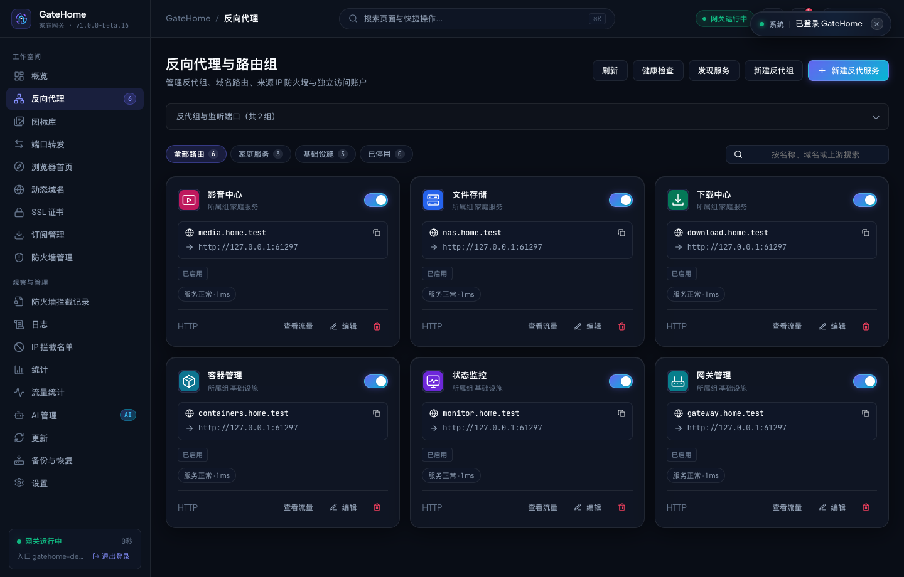
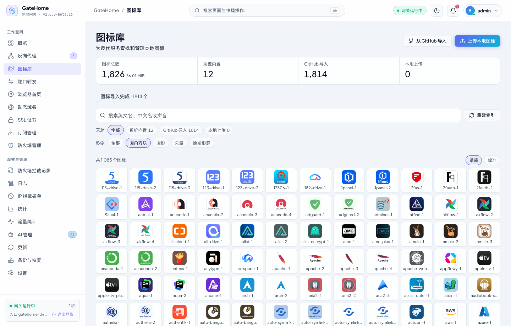

# GateHome

GateHome 是面向家庭服务器和内网服务的自托管网关。Go 程序内嵌中文管理台和 Sun-Panel，运行时只需一个程序或容器。

## 主要功能

- **反向代理与端口转发** · 按域名和监听组管理 HTTP、HTTPS、WebSocket 服务，发现内网应用，配置独立的 TCP / UDP 转发。
- **动态域名与证书** · 多组 Cloudflare DDNS、IPv4 / IPv6 同步和 Let's Encrypt DNS-01 证书签发及续期。
- **访问控制与监控** · IP / CIDR 规则、订阅、服务账号、WAF 和限速，支持健康检查、访问日志和流量统计。
- **图标库与浏览器首页** · 搜索内置图标，从 GitHub 导入或批量上传，再从反代编辑器直接选用。可启用内置 Sun-Panel 作为独立首页。
- **运维与 AI 接入** · 支持在线更新、回滚、加密备份、WebDAV 定时备份和细粒度 [MCP 授权](docs/MCP.md)。

## 界面预览

截图来自演示实例。管理台支持明暗主题和手机布局。图标库截图展示了从 [HD-Icons](https://github.com/xushier/HD-Icons) 导入的图标。





## 安装

当前源码的功能可通过 Docker 构建，或从 [GitHub Releases](https://github.com/Mo-SeTian/GateHome/releases) 下载 Beta 完整安装包。安装后，在局域网访问 `http://服务器IP:16666`。管理端口请限制在可信网络内。

### Docker Compose

在项目目录运行。Linux 主机优先使用默认的 host 网络，便于按客户端真实 IP 执行访问策略。

```bash
git clone https://github.com/Mo-SeTian/GateHome.git
cd GateHome
docker compose build
docker compose run --rm gatehouse init
docker compose up -d
```

Docker Desktop 或需要隔离容器网络时，可使用 bridge 配置。

```bash
docker compose -f compose.bridge.yaml build
docker compose -f compose.bridge.yaml run --rm gatehouse init
docker compose -f compose.bridge.yaml up -d
```

首次运行 `init` 时设置管理员密码，默认账号为 `admin`。已有 `config/state.json` 时直接启动，重复运行 `init` 会重置密码。默认管理端口为 `16666`，反代端口为 `18080`（HTTP）和 `18443`（HTTPS），Sun-Panel 启用后默认使用 `16680`。使用 bridge 时，新增或修改监听需同步发布相应端口，原生 UDP 转发须发布 UDP 端口。

### Linux systemd

从 [Releases](https://github.com/Mo-SeTian/GateHome/releases) 下载对应架构的 `gatehome-linux-amd64.tar.gz` 或 `gatehome-linux-arm64.tar.gz`，在空目录解压后运行：

```bash
sudo bash install.sh install
```

安装脚本会验证程序校验值、创建 `gatehouse` 系统用户并启动 `gatehouse.service`。首次安装在终端设置管理员密码。重新安装会升级启动器和程序，并保留持久化目录。安装脚本会重写自带的管理监听配置，使用自定义监听地址的实例需核对 `/etc/systemd/system/gatehouse.service.d/admin.conf`。

若要通过脚本联网安装 [GitHub Latest 正式版](https://github.com/Mo-SeTian/GateHome/releases/latest)：

```bash
curl -fsSL https://raw.githubusercontent.com/Mo-SeTian/GateHome/main/install.sh -o gatehome-install.sh
sudo bash gatehome-install.sh install
```

图标库随 Beta 提供。使用 systemd 从旧版升级到包含图标库的版本时，请通过完整安装包同步更新启动器，以支持新图标路径的备份和回滚。可用 `systemctl status gatehouse` 查看状态、用 `journalctl -u gatehouse` 查看启动日志。卸载使用 `sudo bash install.sh uninstall`，默认保留持久化目录。

### 直接运行二进制

可使用安装包 `dist/` 中对应架构的程序，或在源码目录用 Go 1.27.1 和 Node.js 22 构建。以下示例使用分离目录，管理界面仅监听本机。

```bash
make build
./dist/gatehouse -data ./.local/runtime/data -config ./.local/runtime/config -log ./.local/runtime/log init
./dist/gatehouse -data ./.local/runtime/data -config ./.local/runtime/config -log ./.local/runtime/log -admin 127.0.0.1:16666
```

省略 `-config` 和 `-log` 时，程序将 `state.json` 写入数据目录，日志写入其 `logs/` 子目录。直接运行可导出备份，网页应用更新、恢复和回滚需要 Docker 或 systemd 启动器。

## 持久化目录

| 内容 | Compose 宿主机 | 容器内 | systemd 安装 |
| --- | --- | --- | --- |
| 配置、账号与凭据 `state.json` | `./runtime/config/` | `/config/` | `/etc/gatehome/config/` |
| 当前及轮转日志 | `./runtime/log/` | `/log/` | `/etc/gatehome/log/` |
| 图标、证书、反代图片、流量统计、订阅缓存与维护数据 | `./runtime/data/` | `/data/` | `/etc/gatehome/data/` |
| Sun-Panel 配置、数据库、上传与自定义文件 | `./runtime/sunpanel/` | `/sunpanel/` | `/etc/gatehome/sunpanel/` |

Compose 的 host 和 bridge 模式使用相同挂载。可设置 `GATEHOME_RUNTIME_DIR` 更换宿主机根目录。Compose 自动准备挂载权限，直接用 `docker run` 时须保证这四个挂载可由容器用户 `10001:10001` 写入。Docker 的业务程序存放在 `/data/app/gatehouse`，systemd 的业务程序和启动器分别位于 `/etc/gatehome/app/gatehouse`、`/etc/gatehome/launcher`。

图标库位于数据目录的 `icons/`（容器内为 `/data/icons/`），包含 `icons/builtin/`、`icons/imported/`、`icons/uploads/` 和 `icons/index.json`。Sun-Panel 数据目录与数据目录同级，直接运行时由 `-data` 的父目录确定。Compose 下的 `runtime/sunpanel/` 对应运行数据，仓库根目录的 `sunpanel/` 存放源码。

完整迁机时先停服，再复制四个持久化目录。网页备份会收录反代路由使用的图标，迁移整库请同时保留 `data/icons/`。从旧版单目录或命名卷迁移时，先备份原数据，再把旧数据目录的内容复制到新部署的 `data/`。启动时程序会将 `state.json` 和 `logs/` 迁移到配置、日志目录，遇到不同内容的目标文件会停止并保留数据。systemd 首次升级旧 `/var/lib/gatehouse` 布局时，安装脚本会复制旧目录并保留原件。

## 开发与验证

`make test` 运行前端单测、Go race 测试和 `go vet`。构建后可运行 Chromium 回归测试。

```bash
make build
npm --prefix frontend exec -- playwright install chromium
npm --prefix frontend run test:browser
```

版本历史见 [发行说明](docs/releases/)。
