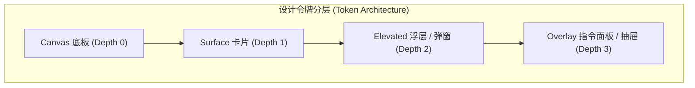

# GateHome · Aurora Next 极客现代控制台设计规范 (Design System Specification)

> **版本**：v1.0 (Aurora Next)  
> **适用范围**：GateHome 管理后台全部 14 个功能页面、登录系统、移动端抽屉与模态浮层  
> **设计基准**：对标 Linear、Vercel 与 Raycast 顶级工程化现代设计语言，保持 Go embed + 原生 HTML/CSS/JS 技术栈约束，零外链字体依赖。

---

## 一、设计哲学与核心定位

### 1.1 从传统后台到现代极客控制台
传统的自托管网关后台大多偏向简单的 Bootstrap 或扁平白底蓝字（如同 Element UI / Ant Design 的传统后台模板），容易产生「粗糙、功能堆砌、廉价工具感」的印象。

**Aurora Next（极光现代版）** 的核心升级目标：
1. **质感至上（Craft & Tactile Feel）**：引入深邃的黑曜极客画布与发丝级微光边界（Hairline Glow），配合微米级内部高光，让界面具有硬件般的精密质感。
2. **生动态势（Luminous Telemetry）**：家庭网关是 7×24 小时运行的核心枢纽，界面不仅静态展示配置，更通过呼吸灯（Radar Ping）、时序柱状图和巡检光扫，实时传达「系统正在稳定运转」的生命力。
3. **极速交互（Keyboard-First & Swift）**：全局支持 `⌘K` / `Ctrl+K` 快速指令面板，微动效采用符合物理特性的弹性缓动曲线，交互干脆利落，杜绝拖沓。
4. **严苛规范（No-Emoji Rule）**：彻底取缔随意散落的 Emoji 符号与单字色块，采用统一线宽（1.8px）、统一视觉重心的工程级矢量 SVG 图标与专属服务 App 徽标。

---

## 二、双主题色彩与设计令牌 (Design Tokens)

系统支持 **黑曜极光（Obsidian Dark · 默认推荐）** 与 **空灵视界（VisionOS Light）** 双主题无缝切换。



### 2.1 颜色令牌体系

| 令牌名 (Token) | 黑曜极光 (Dark Mode) | 空灵视界 (Light Mode) | 说明与设计用途 |
|---|---|---|---|
| `--canvas` | `#090d16` (深空黑曜) | `#f1f5f9` (雾光冷灰) | 全局最底层视口画布 |
| `--sidebar-bg` | `rgba(13, 18, 30, 0.95)` | `rgba(255, 255, 255, 0.95)` | 侧边栏/抽屉背板（带 16px 毛玻璃） |
| `--card-bg` | `rgba(17, 24, 39, 0.75)` | `rgba(255, 255, 255, 0.85)` | Bento 卡片与服务卡片背景色 |
| `--card-hover-bg` | `rgba(23, 32, 51, 0.90)` | `#ffffff` | 鼠标悬停时的卡片反光背景 |
| `--card-border` | `rgba(255, 255, 255, 0.08)` | `rgba(226, 232, 240, 0.90)` | 1px 发丝边线 |
| `--card-border-hover` | `rgba(99, 102, 241, 0.35)` | `rgba(99, 102, 241, 0.40)` | 鼠标悬浮时的品牌激光高光边 |
| `--inner-highlight` | `inset 0 1px 0 rgba(255,255,255,0.08)` | `inset 0 1px 0 rgba(255,255,255,0.9)` | 卡片顶部 1px 模拟光线折射高光 |
| `--ink` | `#f8fafc` | `#0f172a` | 主要标题、服务名称、强文字 (WCAG 7:1) |
| `--ink-secondary` | `#cbd5e1` | `#334155` | 关键数值、重要副标题 (WCAG > 4.5:1) |
| `--muted` | `#94a3b8` | `#475569` | 标签说明、辅助文字 (WCAG > 4.5:1) |
| `--faint` | `#64748b` | `#64748b` | 装饰性小标签、端口等宽码 |
| `--line` | `rgba(255, 255, 255, 0.08)` | `#e2e8f0` | 分割线与细微边框 |
| `--strip-bg` | `rgba(15, 23, 42, 0.60)` | `#f8fafc` | 内网地址条等嵌入式次级背景 |

### 2.2 品牌与状态强调色

- **极光品牌蓝紫**：`--brand: #6366f1`，渐变 `linear-gradient(135deg, #6366f1 0%, #06b6d4 100%)`
- **品牌外发光**：`--brand-glow: 0 0 24px rgba(99, 102, 241, 0.35)`
- **探针就绪绿**：`--ok: #10b981`，光环 `--ok-glow: 0 0 12px rgba(16, 185, 129, 0.4)`
- **告警阻断红**：`--bad: #f43f5e`，光环 `--bad-glow: 0 0 14px rgba(244, 63, 94, 0.45)`
- **预警指示黄**：`--warn: #f59e0b`

---

## 三、空间布局与 Bento 便当盒架构

```
┌────────────────────────────────────────────────────────────────────────┐
│  GateHome Topbar [ ⌘K 指令集 ] [ 巡检光扫 ] [ 告警模拟 ] [ 视口切换 ]    │
├──────────────┬─────────────────────────────────────────────────────────┤
│              │  页面标题 + 快捷操作区 (接入路由 / 刷新探针)             │
│   240px      ├─────────────────────────────────────────────────────────┤
│   侧边栏     │  Bento 态势带 (服务实例 / 探针正常 / 异常阻断 / 时序)   │
│   (纯白/深空 │  [ 7 条 ]     [ 6 正常 ]   [ 1 未通 ]    [ ▇▅█ 动态 ]  │
│    毛玻璃)   ├─────────────────────────────────────────────────────────┤
│              │  筛选胶囊行 (全部 7 / 家庭云 4 / 影音 3)                │
│   核心导航   ├─────────────────────────────────────────────────────────┤
│   安全运维   │  4 列 Aurora 光斑卡片网格                                │
│              │  ┌──────────┐ ┌──────────┐ ┌──────────┐ ┌──────────┐    │
│   在线探针   │  │ 🖴 NAS   │ │ 📷 相册  │ │ 🏠 HA    │ │ 📶 软路由│    │
│   延迟 2ms   │  └──────────┘ └──────────┘ └──────────┘ └──────────┘    │
└──────────────┴─────────────────────────────────────────────────────────┘
```

### 3.1 响应式视口断点与布局映射

| 视口档位 | 宽度定义 | 侧边栏呈现模式 | Bento 态势带 | 卡片网格列数 | 交互特性 |
|---|---|---|---|---|---|
| **超宽大屏** | `≥ 1401px` | 常驻 240px 桌面侧栏 | 5 列并排 (`repeat(4, 1fr) 1.65fr`) | **4 列** 并排 | 游标光斑完全开启，hover 上浮 3px |
| **标准桌面** | `1181px – 1400px` | 常驻 240px 桌面侧栏 | 5 列并排 | **3 列** 并排 | 内网地址条自适应收缩 |
| **平板中屏** | `841px – 1180px` | 常驻 240px 桌面侧栏 | 4 列指标 + 时序占整行 | **2 列** 并排 | 标签紧凑折叠 |
| **手机竖屏** | `≤ 840px` | **收起为 280px 磨砂抽屉** | 2×2 网格 + 时序占整行 | **1 列** 贯穿到底 | 唤出吸顶导航栏，触控按钮 ≥44px |

### 3.2 移动端抽屉无黑边架构规范
针对移动端抽屉收起与展开的几何约束：
1. **隐藏状态（Closed）**：
   - 必须显式声明 `transform: translateX(-105%)` 与 `visibility: hidden; box-shadow: none;`。
   - **绝对禁止在隐藏状态下保留向右延伸的 X 轴偏移阴影**（如 `box-shadow: 25px 0 60px`），否则阴影模糊半径会渗透进屏幕左边缘形成脏黑边。
2. **展开状态（Open）**：
   - 触发 `stage.classList.add('drawer-open')`。
   - `transform: translateX(0); visibility: visible;`。
   - 激活遮罩背景 `.drawer-scrim`：`opacity: 1; pointer-events: auto; backdrop-filter: blur(8px)`。
3. **真实机型贴边规范**：
   - 在真实手机（`@media (max-width: 768px)`）下，容器外边距归零（`padding: 0;`），去除所有模拟边框与刘海伪元素，实现 100% 全屏原生贴边体验。

---

## 四、图标与品牌视觉系统 (Iconography)

### 4.1 全局网页 Favicon 规范
在 `<head>` 中嵌入高分辨率矢量 Data URI，确保在任何分辨率、Dark/Light 浏览器标签页中均清晰发光：

```html
<link rel="icon" type="image/svg+xml" href="data:image/svg+xml,%3Csvg xmlns='http://www.w3.org/2000/svg' viewBox='0 0 32 32'%3E%3Cdefs%3E%3ClinearGradient id='g' x1='0%25' y1='0%25' x2='100%25' y2='100%25'%3E%3Cstop offset='0%25' stop-color='%236366f1'/%3E%3Cstop offset='100%25' stop-color='%2306b6d4'/%3E%3C/linearGradient%3E%3C/defs%3E%3Crect width='32' height='32' rx='9' fill='url(%23g)'/%3E%3Cpath d='M16 6L6 11.5v9L16 26l10-5.5v-9L16 6zm0 3.2l6.8 3.7-6.8 3.8-6.8-3.8L16 9.2zm-7.6 9.8v-6.3l6.6 3.7v6.3L8.4 19zm8.6 3.7v-6.3l6.6-3.7v6.3L17 22.7z' fill='%23ffffff'/%3E%3C/svg%3E">
```

### 4.2 侧边栏统一矢量线条规范
- 基础网格：`24×24` viewBox，统一限制呈现为 `18×18px`。
- 线宽与端点：`stroke-width="1.8"`，`stroke-linecap="round"`，`stroke-linejoin="round"`。
- 填充方式：`fill="none"`，仅线条描边，颜色继承 `currentColor`。

| 菜单模块 | 图标语义 | 对应 SVG 路径特征 |
|---|---|---|
| **Bento 概览** | 四块异构便当盒 | 4 个带圆角矩形组成的模块化矩阵 |
| **反向代理** | 双向分支路由 | 对向分流折线与源节点连线 |
| **动态 DDNS** | 经纬环绕全球网络 | 经纬交叉球体（Globe） |
| **SSL 证书** | 安全验证徽章 | 带有内嵌勾选的盾牌 |
| **WAF 防火墙** | 入侵警示盾牌 | 带有中心警告核的防御盾 |
| **审计日志** | 终端命令行文档 | 顶部折角文档 + 代码行脉冲 |
| **流量图谱** | 心电波形活动雷达 | 实时动态折线波形 |
| **加密备份** | 冗余数据卷宗 | 三层圆柱型分布式磁盘阵列 |
| **全局设置** | 精细调节滑轨 | 错落分布的现代参数微调旋钮 |

### 4.3 7 大服务卡片专属 App 矢量徽章规范
告别过时的汉字色块，每类服务拥有具象、高级的立体渐变微质感图标：

1. **家庭私有 NAS (Synology / TrueNAS)**：
   - 渐变底块：`linear-gradient(135deg, #3b82f6, #1d4ed8)` (钴蓝)
   - 矢量符号：双盘位企业级刀片存储机架，自带独立 LED 状态脉冲点。
2. **家庭相册 Immich**：
   - 渐变底块：`linear-gradient(135deg, #f59e0b, #b45309)` (落日琥珀)
   - 矢量符号：圆角景深相框与多层对焦光圈棱镜。
3. **Home Assistant (智能家居)**：
   - 渐变底块：`linear-gradient(135deg, #10b981, #047857)` (翡翠绿)
   - 矢量符号：带有物联网中心节点的智能屋檐与交互门廊。
4. **软路由网关 (OpenWrt / iKuai)**：
   - 渐变底块：`linear-gradient(135deg, #8b5cf6, #6d28d9)` (电光紫)
   - 矢量符号：双天线高增益千兆千兆路由实体 + 状态指示灯。
5. **Jellyfin 4K 媒体库**：
   - 渐变底块：`linear-gradient(135deg, #06b6d4, #0e7490)` (极客青)
   - 矢量符号：立体流媒体投影播放棱镜与暗色折光面。
6. **qBittorrent 节点**：
   - 渐变底块：`linear-gradient(135deg, #f43f5e, #be123c)` (霓虹玫瑰)
   - 矢量符号：高速磁力穿透式下行速度流箭头。
7. **文件直通 WebDAV**：
   - 渐变底块：`linear-gradient(135deg, #f59e0b, #d97706)` (金棕)
   - 矢量符号：带向外投射弧度的多功能资料卷宗库。

---

## 五、动效系统与微交互规范 (Motion System)

### 5.1 缓动函数与时间常数 (Motion Constants)

```css
--ease-spring: cubic-bezier(0.2, 0.7, 0.3, 1);
--ease-snap: cubic-bezier(0.4, 0, 0.2, 1);
```

| 交互场景 | 持续时间 (Duration) | 缓动曲线 | 动作属性 | 中断与接管策略 |
|---|---|---|---|---|
| **游标聚光灯跟随** | 即时 (0ms 延迟) | Linear | CSS `--mouse-x`, `--mouse-y` | `requestAnimationFrame` 驱动，指针离开 300ms 淡出 |
| **卡片悬浮浮起** | 220ms | `--ease-spring` | `transform: translateY(-3px)` | 鼠标移出时 180ms 柔和回弹 |
| **巡检光束扫描** | 1200ms 循环 | Linear | `left: -100% → 100%` (2.5px 极光束) | 探活结束时渐隐，不突兀截断 |
| **⌘K 指令面板唤出** | 240ms | `--ease-spring` | `opacity 0→1, scale 0.97→1, Y -10px→0` | 按 Esc 立即反向 160ms 退出 |
| **手机抽屉侧栏滑入** | 280ms | `--ease-spring` | `transform: translateX(-105% → 0)` | 点击遮罩随时反向打断关闭 |
| **雷达呼吸探活** | 2500ms 循环 | `cubic-bezier(0, 0, 0.2, 1)` | `scale 0.9→2.2, opacity 0.8→0` | 全站唯一静默长周期动画 |

### 5.2 游标聚光灯（Cursor Spotlight）实现规范
鼠标在网格内移动时，每张卡片通过原生 CSS 变量实时感应光源：

```javascript
document.addEventListener('mousemove', (e) => {
  const cards = document.querySelectorAll('.aurora-card, .bento-item');
  cards.forEach(card => {
    const rect = card.getBoundingClientRect();
    card.style.setProperty('--mouse-x', `${e.clientX - rect.left}px`);
    card.style.setProperty('--mouse-y', `${e.clientY - rect.top}px`);
  });
});
```

```css
.aurora-card::before {
  content: "";
  position: absolute;
  inset: 0;
  border-radius: inherit;
  background: radial-gradient(350px circle at var(--mouse-x, 50%) var(--mouse-y, 50%), var(--spotlight-color), transparent 60%);
  opacity: 0;
  pointer-events: none;
  transition: opacity .3s ease;
  z-index: 1;
}
.aurora-card:hover::before { opacity: 1; }
```

### 5.3 无障碍回退（`prefers-reduced-motion`）
当系统开启减弱动态效果时：
- 禁用卡片 `translateY` 抬升和扫描光束流动；
- 将透明度淡入压缩至 0.01ms；
- 保留颜色状态变化（绿变红）与静态指示徽标，确保信息可达性 100% 完整。

---

## 六、实施边界与技术落地约束

1. **零外部字体引入**：严格锁定系统字体栈 `-apple-system, BlinkMacSystemFont, "Segoe UI", Roboto, "Inter", "PingFang SC"` 与等宽字体 `"JetBrains Mono", "SF Mono", monospace`，杜绝任何外部 WebFonts 导致的字体闪烁（FOIT/FOUT）与离线运行故障。
2. **Go 后端零侵入**：本轮 UI/UX 重构仅限 `internal/gateway/web/` 目录下的 CSS、HTML 模版与 JavaScript 渲染逻辑，不修改任何 Go 数据结构、API 路由或 SQLite 表定义。
3. **Sun-Panel 独立性**：Sun-Panel 首页使用独立 iframe 嵌入，GateHome 仅负责外层外壳与端口生命周期管理，不向其内部注入任何 CSS 破坏其原有排版。
4. **自动化回归门禁**：改动提交前，必须全部通过项目内置的自动化校验：
   ```bash
   node scripts/frontend_checks.mjs
   node scripts/motion_checks.mjs
   node scripts/security_checks.mjs
   node scripts/ui_checks.mjs
   ```
