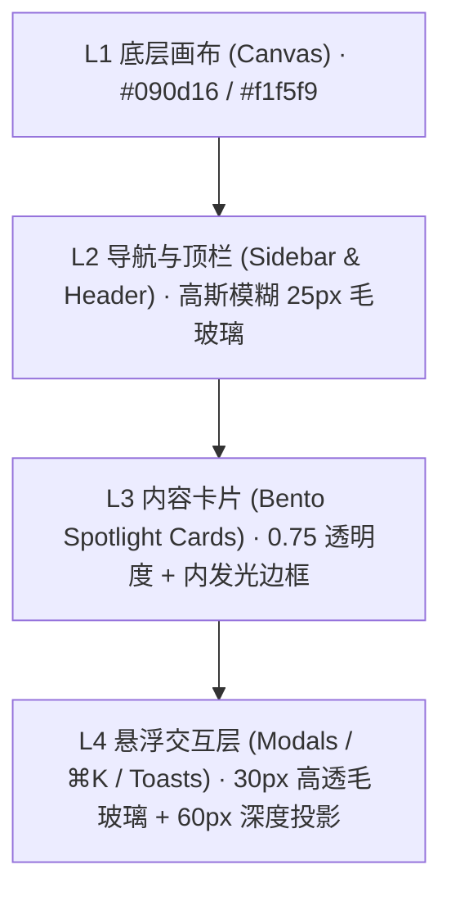

# GateHome · Aurora Next 现代化 Vue 3 前端设计规范与全交互模版工程指南

> **版本**：v1.1.0 · 2026-11-09  
> **适用内核**：GateHome (Go 1.23.2 · v0.0.67-beta.3 及后续版本)  
> **前端技术栈**：Vue 3.5 (`<script setup>`) + Vite 6 + Vue Router 4 + Lucide Icons + CSS Custom Properties  
> **设计语言**：Aurora Next (极客暗曜石 Obsidian Tech & 清透磨砂白 VisionOS White)

> **迁移完成说明**：本文保留设计与 Mock 模版阶段的背景。`1.0.0` 已完成登录、账户与全部 17 页真实 API 对接及 Go 静态资源嵌入；当前入口、数据保留与部署方式以 [交接说明](../../docs/aurora-next-1.0.0-handover.md) 和 [验收清单](../../docs/aurora-next-migration-checklist.md) 为准。

---

## 目录
1. [设计稿与工程资源索引指引](#1-设计稿与工程资源索引指引)
2. [色调系统与材质层次规范](#2-色调系统与材质层次规范)
3. [UI 布局架构与多端响应式规范](#3-ui-布局架构与多端响应式规范)
4. [动效体系与微交互规范 (Motion System)](#4-动效体系与微交互规范-motion-system)
5. [侧边栏导航与 17 个页面全景对照](#5-侧边栏导航与-17-个页面全景对照)
6. [核心业务模型深度设计](#6-核心业务模型深度设计)
7. [组件库实现解析](#7-组件库实现解析)
8. [开发者快速上手与部署](#8-开发者快速上手与部署)

---

## 1. 设计稿与工程资源索引指引

所有设计稿、原型文件与前端代码均已保存在工作空间中，可随时通过本地浏览器或代码编辑器访问查看：

| 资产类型 | 文件路径 / 访问地址 | 说明与用途 |
|---|---|---|
| **Vue 3 实时交互环境** | [http://localhost:5173/](http://localhost:5173/) | **主开发交互预览**。已启动本地 Vite 服务，包含登录鉴权拦截与全部 17 个真实功能页面，支持热重载。 |
| **Vue 3 工程源代码** | [`frontend/`](../../frontend) | 完整的 Vue 3 源码目录（包含 `src/views/` 17个页面+登录页、`src/components/` 6个核心组件、样式与状态）。 |
| **生产打包构建产物** | [`frontend/dist/index.html`](../../frontend/dist/index.html) | `npm run build` 生成的纯静态产物（包含 `dist/assets/*`），可直接供 Go `//go:embed` 打包。 |
| **单文件独立原型 A** | [`preview-modern.html`](../../preview-modern.html) | **Aurora Next 极客现代原型**（单文件 HTML，双主题切换、Spotlight 光晕、纯手绘 SVG 图标）。 |
| **单文件独立原型 B** | [`preview-dawn.html`](../../preview-dawn.html) | **Dawn Console 晨曦浅色概念原型**（单文件 HTML，高对比浅色排版）。 |
| **设计系统规范文档** | [`AURORA-NEXT-SPEC.md`](./AURORA-NEXT-SPEC.md) | 基础视觉 Token 规范、图标绘制原则与组件设计标准定义。 |

---

## 2. 色调系统与材质层次规范

Aurora Next 采用**双模态双引擎配色**：以黑曜石极客暗黑模式为主打，辅以 Apple VisionOS 风格的高透磨砂白，满足不同光照环境的使用需求。

### 2.1 界面材质层级 (Surface Hierarchy)



### 2.2 色值与 CSS Tokens

```css
:root {
  /* 品牌极光主色 (Brand Accents) */
  --brand: #6366f1;          /* 极光紫罗兰 (Indigo 500) */
  --brand-light: #818cf8;    /* 亮紫 (Indigo 400) */
  --brand-cyan: #06b6d4;     /* 极光青 (Cyan 500) */
  --brand-gradient: linear-gradient(135deg, #6366f1 0%, #06b6d4 100%);
  --brand-glow: 0 0 24px rgba(99, 102, 241, 0.35);

  /* 状态警示色 (Status Colors) */
  --ok: #10b981;             /* 翠绿 · 运行正常 / 成功 */
  --ok-glow: 0 0 12px rgba(16, 185, 129, 0.4);
  --warn: #f59e0b;           /* 琥珀黄 · 临期预警 / 同步中 */
  --bad: #f43f5e;            /* 玫瑰红 · 拦截阻断 / 致命故障 */
  --bad-glow: 0 0 14px rgba(244, 63, 94, 0.45);
  --info: #38bdf8;           /* 天空蓝 · 信息提示 */

  /* 圆角标准 (Radii) */
  --radius-card: 16px;       /* Bento 大卡片圆角 */
  --radius-md: 12px;         /* 中型容器圆角 */
  --radius-sm: 8px;          /* 按钮、输入框圆角 */
  --radius-pill: 999px;      /* 药丸徽章圆角 */
}

/* ================= 暗曜石深色模式 (Obsidian Tech - 默认) ================= */
body.theme-dark {
  --canvas: #090d16;                             /* 深空墨色底板 */
  --sidebar-bg: rgba(13, 18, 30, 0.95);          /* 侧栏 95% 不透明毛玻璃 */
  --card-bg: rgba(17, 24, 39, 0.75);             /* 卡片 75% 磨砂灰 */
  --card-hover-bg: rgba(23, 32, 51, 0.9);
  --card-border: rgba(255, 255, 255, 0.08);      /* 8% 纯白物理精细边框 */
  --card-border-hover: rgba(99, 102, 241, 0.35); /* 悬浮时品牌紫高亮边 */
  --inner-highlight: inset 0 1px 0 rgba(255, 255, 255, 0.08); /* 顶部微光线 */
  
  --ink: #f8fafc;                                /* 一级高亮文字 (Slate 50) */
  --ink-secondary: #cbd5e1;                      /* 二级正文文字 (Slate 300) */
  --muted: #94a3b8;                              /* 弱化辅助文字 (Slate 400) */
  --faint: #64748b;                              /* 注释/图标默认色 (Slate 500) */
  --line: rgba(255, 255, 255, 0.08);             /* 分割线 */
  --strip-bg: rgba(15, 23, 42, 0.6);             /* 表格与微卡条底色 */
  --input-bg: rgba(15, 23, 42, 0.85);

  --spotlight-color: rgba(99, 102, 241, 0.12);   /* 鼠标光晕径向色 */
  --shadow-card: 0 8px 30px rgba(0, 0, 0, 0.4);
  --shadow-hover: 0 16px 40px rgba(0, 0, 0, 0.6), 0 0 30px rgba(99, 102, 241, 0.15);
}

/* ================= VisionOS 浅色模式 (Frosted White) ================= */
body.theme-light {
  --canvas: #f1f5f9;                             /* 清爽浅灰画布 (Slate 100) */
  --sidebar-bg: rgba(255, 255, 255, 0.95);       /* 纯净 95% 白玻璃 */
  --card-bg: rgba(255, 255, 255, 0.85);          /* 85% 雾面白色 */
  --card-hover-bg: #ffffff;
  --card-border: rgba(226, 232, 240, 0.9);       /* 细致浅灰边框 */
  --card-border-hover: rgba(99, 102, 241, 0.4);
  --inner-highlight: inset 0 1px 0 rgba(255, 255, 255, 0.9);

  --ink: #0f172a;                                /* 一级文字 (Slate 900) */
  --ink-secondary: #334155;                      /* 二级文字 (Slate 700) */
  --muted: #475569;                              /* 辅助文字 (Slate 600) */
  --faint: #64748b;
  --line: #e2e8f0;
  --strip-bg: #f8fafc;
  --input-bg: #ffffff;

  --spotlight-color: rgba(99, 102, 241, 0.08);
  --shadow-card: 0 4px 16px rgba(15, 23, 42, 0.04);
  --shadow-hover: 0 16px 36px -4px rgba(15, 23, 42, 0.12), 0 0 20px rgba(99, 102, 241, 0.12);
}
```

---

## 3. UI 布局架构与多端响应式规范

### 3.1 视口骨架与布局尺寸
- **侧边栏宽度**：`240px` 固定宽。
- **顶部顶栏高度**：`60px` 固定高，`sticky` 悬浮跟随，带 `backdrop-filter: blur(20px)`。
- **主内容区安全宽度**：最大 `1540px` 居中，内边距 `24px`。

```
+-------------------------------------------------------------------------+
| TopHeader: [Logo/Drawer] [Breadcrumb] [=== ⌘K Search ===] [Theme] [User] |
+------------------+------------------------------------------------------+
| Sidebar (240px)  | Page Content Viewport (max-width: 1540px)            |
|                  |                                                      |
| [工作空间]        | [Page Topbar: Title, Subtitle, Primary Actions]      |
| · 概览           | +--------------------------------------------------+ |
| · 反向代理       | | Bento 4-Columns Grid / 2-Columns Partition Cards | |
| · 端口转发       | |                                                  | |
| · ...            | | [SpotlightCard]  [SpotlightCard]  [SpotlightCard]| |
|                  | +--------------------------------------------------+ |
| [观察与管理]      | | Interactive Tables / Wave SVG Radars / Playgrounds| |
| · 流量统计       | +--------------------------------------------------+ |
| · 更新           |                                                      |
| · ...            |                                                      |
+------------------+------------------------------------------------------+
```

### 3.2 响应式断点与行为模式

| 设备类型 | 屏幕断点 | 布局形态 | 关键交互适配 |
|---|---|---|---|
| **桌面大屏** | `>= 1300px` | 完整形态 | Bento 4列卡片并排、侧边栏固定、顶部完整 ⌘K 搜索条 |
| **标准笔记本**| `1024px ~ 1299px` | 紧凑桌面 | 卡片自适应为 3列 / 2列、右侧统计折叠下移 |
| **平板移动端**| `768px ~ 1023px` | 抽屉模式 | 侧边栏隐藏为左滑抽屉，顶部露出汉堡菜单图标，搜索条折叠为图标 |
| **竖屏手机** | `< 768px` | 单列流式 | 侧边栏绝对隐藏（彻底去除左侧黑边溢出，开启时全屏高斯模糊）；卡片 1 列垂直排列 |

---

## 4. 动效体系与微交互规范 (Motion System)

Aurora Next 拒绝生硬机械的位移，全站统一采用**物理弹簧减速曲线**：
$$\text{cubic-bezier}(0.16, 1, 0.3, 1)$$

### 4.1 光晕跟随算法 (Spotlight Card)
每个卡片包含一个 `SpotlightOverlay` 层，通过监听 `mousemove` 事件计算相对卡片左上角的偏移量：

```javascript
// SpotlightCard.vue
const handleMouseMove = (e) => {
  const rect = cardRef.value.getBoundingClientRect()
  mouseX.value = e.clientX - rect.left
  mouseY.value = e.clientY - rect.top
  isHovered.value = true
}
```

```css
.spotlight-overlay {
  background: radial-gradient(
    450px circle at var(--spotlight-x, 0px) var(--spotlight-y, 0px),
    var(--spotlight-color),
    transparent 70%
  );
  opacity: var(--spotlight-opacity, 0);
  transition: opacity 0.3s ease;
}
```

### 4.2 路由页面切换动效 (Page Fade & Slide)
页面切换时旧视图轻微上浮淡出，新视图从下方微移淡入，耗时 `200ms`：

```css
.page-fade-enter-active, .page-fade-leave-active {
  transition: opacity 0.2s cubic-bezier(0.16, 1, 0.3, 1), transform 0.2s cubic-bezier(0.16, 1, 0.3, 1);
}
.page-fade-enter-from { opacity: 0; transform: translateY(6px); }
.page-fade-leave-to   { opacity: 0; transform: translateY(-4px); }
```

### 4.3 全局命令面板 (⌘K Modal Scale & Blur)
唤起 `⌘K` 时背景以 8px 高斯模糊渐显，弹窗自中心微缩放进入：

```css
@keyframes cmdkPop {
  from { opacity: 0; transform: scale(0.97) translateY(-10px); }
  to   { opacity: 1; transform: scale(1) translateY(0); }
}
```

### 4.4 移动端滑动抽屉无漏光设计
彻底杜绝移动端左侧黑边或伪外框渗光问题：
```css
/* 默认收起态：完全隐藏并移出视口，不投射任何阴影 */
.app-sidebar {
  transform: translateX(-105%);
  visibility: hidden;
  box-shadow: none;
  transition: transform 0.3s cubic-bezier(0.16, 1, 0.3, 1), visibility 0.3s ease;
}
/* 展开态：滑入并施加深空投影 */
.app-sidebar.mobile-open {
  transform: translateX(0);
  visibility: visible;
  box-shadow: 25px 0 60px rgba(0, 0, 0, 0.7);
}
```

### 4.5 脉冲呼吸指示灯 (Pulse Indicators)
网关运行正常状态、波形图监测点采用微呼吸动效：
```css
@keyframes pulseDot {
  0%, 100% { opacity: 1; transform: scale(1); }
  50%      { opacity: 0.4; transform: scale(0.85); }
}
```

---

## 5. 侧边栏导航与 17 个页面全景对照

侧边栏严格按照 GateHome 源码结构组织为 **两大分组、共 17 个菜单项**：

```
+-- 工作空间 (Workspace) --------------------------+
|  1. 概览              [#/overview]               |
|  2. 反向代理          [#/routes] (带数量Badge)    |
|  3. 端口转发          [#/forwards]               |
|  4. 浏览器首页        [#/sunpanel]               |
|  5. 动态域名          [#/ddns]                   |
|  6. SSL 证书          [#/certificates] (带临期1)  |
|  7. 订阅管理          [#/subscriptions] (IP订阅) |
|  8. 防火墙管理        [#/access] (带运行绿点)     |
+-- 观察与管理 (Management) -----------------------+
|  9. 防火墙拦截记录    [#/firewall-logs]          |
| 10. 日志              [#/logs] (双轨日志)        |
| 11. IP 拦截名单       [#/ip-blocks] (IP冻结)     |
| 12. 统计              [#/statistics] (QPS趋势)   |
| 13. 流量统计          [#/traffic] (反代带宽)     |
| 14. AI 管理           [#/mcp] (MCP沙箱)          |
| 15. 更新              [#/updates] (版本回滚)     |
| 16. 备份与恢复        [#/backups] (WebDAV)       |
| 17. 设置              [#/settings]               |
+--------------------------------------------------+
```

---

## 6. 核心业务模型深度设计

### 6.1 IP 规则订阅与防火墙 IP 组联动 (IP Subscriptions)
- **业务实际**：非节点翻墙订阅，而是 **IP / CIDR 规则订阅**（支持 IPv4 / IPv6，支持 `#` 注释）。
- **预设集成**：支持一键快速导入 `mayaxcn/china-ip-list` 官方亚太地址分配表。
- **防火墙多级前缀索引**：在防火墙规则中勾选订阅后，后台解析并编译进 `prefixIndex`，实现纳秒级 IP 访问鉴权。

### 6.2 反代组 (ProxyGroup) 与 域名路由 (Route) 体系
- **反代组 (`ProxyGroup`)**：每个组支持独立配置 HTTP/HTTPS 端口（如 80/443、8080/8443）、域名后缀（Domain Suffix）与绑定 DDNS 组。
- **域名规则 (`Route`)**：可挂载来源 IP 防火墙，并支持前置账号密码鉴权（带连续输错次数限制与封禁时长）。

### 6.3 Coraza 3.8.1 · OWASP CRS 4.25.0 Web 攻击防御
- **WAF 模式**：`block` (拦截攻击) / `detect` (仅审计记录) / `off` (关闭)。
- **PL 等级**：PL1 至 PL4。
- **规则例外**：支持按 CRS 规则 ID（如 942100）、域名与路径前缀豁免特定误报接口。

### 6.4 双轨日志引擎
- **反代访问日志**：记录入站请求的 URI、状态码、响应耗时、客户端 IP 及 `ip2region` 离线地理归属地、触发的安全规则。
- **项目系统日志**：记录 DDNS 域名同步、IP 订阅拉取更新、SSL 证书自动续期与管理调用操作。

### 6.5 IP 冻结机制 (Frozen IPs)
- 记录达到验证失败上限、触发 WAF 规则或管理员手动冻结的 IP。
- 界面展示剩余有效时间倒计时，到期自动解除拦截。

### 6.6 流量统计与在线更新
- **流量统计**：按反代规则与时间范围汇总查看上传量 (TX) 与下载量 (RX)。
- **在线更新**：支持稳定版与公测 Beta 切换，更新前自动打包完整配置快照，随时支持一键回滚历史版本。

---

## 7. 组件库与页面实现解析

组件与视图代码位于 [`frontend/src/`](../../frontend/src)：

1. **`LoginView.vue` (`#/login`)**：**独立登录全景视窗**。融入极光浮动光晕（Aurora Floating Orbs）、Spotlight 游标跟随、官方 `GATEHOUSE CONSOLE` 品牌徽标、免密一键极速体验通道，并支持内联展开 `gatehouse init` 终端密码重置指引。配合 `router.beforeEach` 全局路由守卫，未登录时自动拦截至此页面。
2. **`AccountModal.vue`**：**管理员账户与密码设置模态窗口**。1:1 对齐 GateHome 的 `account-dialog`，支持修改管理员账号、当前密码校验、12-72 字节新密码设定与会话退出重登联动。
3. **`SpotlightCard.vue`**：提供鼠标光晕高亮容器，支持嵌套任意内容。
4. **`CmdkModal.vue`**：全局快捷命令面板，支持拼音模糊检索 17 个模块、修改密码、退出登录与快捷创建。
5. **`Sidebar.vue`**：自适应侧边栏，移动端平滑抽屉，集成系统运行状态徽章与底部退出登录。
6. **`TopHeader.vue`**：统一顶栏，包含汉堡菜单、面包屑、⌘K 快捷启动条、主题切换（Sun/Moon）、管理员个人下拉菜单（查看角色、修改密码、登出）。
7. **`ToastNotification.vue`**：浮动操作反馈气泡，支持成功、警告、失败等状态提示。

---

## 8. 开发者快速上手与部署

```bash
# 1. 运行本地开发调试 (Vite HMR 热重载)
cd frontend
npm run dev
# 浏览器访问: http://localhost:5173/

# 2. 生产环境打包 (输出至 dist/)
npm run build

# 3. 本地预览生产构建产物
npm run preview
```

构建产物已优化为相对路径模式，未来仅需在 Go 代码中使用 `//go:embed all:dist` 即可将整个极客现代控制台打包进单个可执行文件中！
