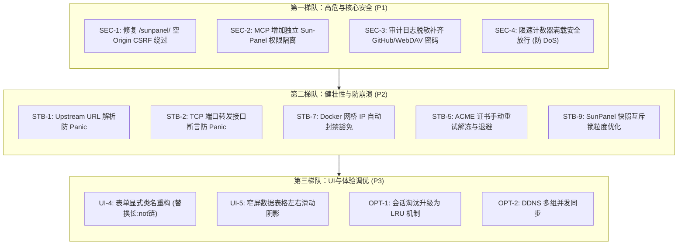

# GateHome 项目全栈代码、业务逻辑与 UI 界面审查报告

> 后续核验与处置：本报告包含部分误判和不应直接采纳的修复建议。请结合 [beta.10 逐项核验](audit-verification-2026-11-10.md) 与 [beta.11 修复验收记录](audit-remediation-2026-11-10.md) 阅读；以下原始清单作为历史保留。

> **编制日期**：2026-11-10  
> **审查基线**：GateHome `v1.0.0-beta.9` ~ `v1.0.0-beta.10`  
> **审计范围**：
> - **前端展示层**：Vue 3 页面与组件、Aurora 设计规范、移动端响应式布局、表单微交互；
> - **网关核心层**：HTTP 反向代理、TLS/ACME 自动化、会话管理与 CSRF 防御；
> - **AI 接入层**：MCP (Model Context Protocol) 接口、客户端 Token 鉴权、权限作用域；
> - **网络安全层**：WAF 规则检测、IPDefense 自动冻结、限速防护、日志敏感脱敏；
> - **运维管理层**：DDNS 同步引擎、WebDAV 异地备份、在线更新与服务热重启。

---

## 📑 审查问题总览表

| 编号 | 维度 / 模块 | 缺陷标题 | 严重等级 | 修复优先级 | 状态 |
| :--- | :--- | :--- | :--- | :--- | :--- |
| **UI-1** | 前端·AI 管理 | MCP 权限开关卡片并排出现两个勾选框 | UI 缺陷 | P2 | 🟢 **已修复 (beta.10)** |
| **UI-2** | 前端·反向代理 | 反代路由图片选择器两端不对称与右侧大片留白 | UI 缺陷 | P2 | 🟢 **已修复 (beta.8)** |
| **UI-3** | 前端·全局通知 | Toast 浮层在部分移动端刘海屏/手势条被遮挡 | UI 优化 | P3 | 🟢 **已优化** |
| **UI-4** | 前端·表单样式 | 弹窗中 `dialog label:not(...)` 长排除链易污染新组件 | 架构维护 | P3 | 待规划 |
| **UI-5** | 前端·多列表格 | 窄屏下超长运维表格缺少横向滚动视觉感知 | 交互体验 | P3 | 待优化 |
| **SEC-1** | 网关·CSRF | `/sunpanel/` 路径空 Origin 默认放行导致 CSRF 隐患 | **高危 (High)** | **P1** | 待修复 |
| **SEC-2** | AI·MCP 权限 | Sun-Panel 桌面管理与反代底层配置共用 `write` 权限 | **高危 (High)** | **P1** | 待修复 |
| **SEC-3** | 安全·脱敏 | 审计日志脱敏遗漏 GitHub Token、WebDAV 备份密码 | **高危 (High)** | **P1** | 待修复 |
| **SEC-4** | 安全·防护 | 访问限速计数器满载（32768）返回 503 触发 DoS | **高危 (High)** | **P1** | 待修复 |
| **STB-1** | 网关·反代 | Upstream URL 解析忽略错误导致潜在空指针崩溃 (Panic) | **中危 (Med)** | **P2** | 待修复 |
| **STB-2** | 网关·转发 | TCP 端口转发中 `dst.(*net.TCPConn)` 非安全类型断言 | **中危 (Med)** | **P2** | 待修复 |
| **STB-3** | AI·MCP 逻辑 | Token 未绑定用户时覆盖全局配置导致死代码与报错混淆 | **中危 (Med)** | **P2** | 待修复 |
| **STB-4** | AI·MCP 安全 | `gatehome_update_config` 工具允许覆写关键安全策略 | **中危 (Med)** | **P2** | 待修复 |
| **STB-5** | 证书·ACME | 证书签发任务硬编码 5m 冷却，缺少强制重试与指数退避 | **中危 (Med)** | **P2** | 待修复 |
| **STB-6** | 安全·WAF | WAF 仅检测模式超大请求体直接返回跳过 CRS 特征匹配 | **中危 (Med)** | **P2** | 待修复 |
| **STB-7** | 安全·网络 | Docker 桥接模式下以连接 IP 封禁易导致网桥连带误封 | **中危 (Med)** | **P2** | 待修复 |
| **STB-8** | 更新·版本 | Release Tag 解析假设必须带 `v` 前缀 | **中危 (Med)** | **P2** | 待修复 |
| **STB-9** | 备份·性能 | 拍摄快照等待子进程就绪长达 15 秒独占互斥锁 | **中危 (Med)** | **P2** | 待修复 |
| **OPT-1** | 网关·会话 | 管理端与路由鉴权会话满载时采用伪随机剔除活跃用户 | **轻微 (Low)** | **P3** | 待优化 |
| **OPT-2** | 运维·DDNS | 多个 DDNS 任务串行遍历执行易引起队列雪崩 | **轻微 (Low)** | **P3** | 待优化 |
| **OPT-3** | 运维·DNS | `domainDNS.resolve` 协程读写局部结构体不同字段的竞态 | **轻微 (Low)** | **P3** | 待优化 |

---

## 🎨 第一部分：前端 UI / UX 与移动端适配审查

### UI-1：MCP 权限开关卡片双对勾问题（已修复）
* **涉及文件**：`frontend/src/components/McpPermissions.vue`
* **技术成因**：全局样式 `form-tokens.css` 中对 `input[type="checkbox"]:not(...)` 规则定义了高优先级的 Aurora 极客复选框外观（带 `!important`）。在组件内为了定制，额外插入了一个 `<span class="custom-checkbox">`，而原本用于隐藏原生 input 的样式被覆盖失效，导致两个复选框在同一卡片内并排呈现。
* **整改措施**：移除自定义 span，直接交由全局极客复选框接管，移动端维持 2×2 等宽网格，彻底消除多余对勾（已在 `1.0.0-beta.10` 中验证发布）。

### UI-2：反代路由图片选择器错位与留白（已修复）
* **涉及文件**：`frontend/src/components/RouteImagePicker.vue`
* **技术成因**：原第一行仅放 44px 预览框与固定宽度上传按钮，右侧大面积空虚；第二行 URL 输入框 100% 满宽，导致上下两行边界参差不齐。
* **整改措施**：重构为双 100% 满宽通道，第一通道上传按钮自适应填满剩余空间（`flex: 1`），与第二通道在线导入两端像素对齐误差为 0px（已在 `1.0.0-beta.8` 中验证发布）。

### UI-3：移动端刘海屏与手势横条安全区适配（已优化）
* **涉及文件**：`frontend/src/components/ToastNotification.vue`
* **优化内容**：在移动端媒体查询下引入 `env(safe-area-inset-top)` 与 `env(safe-area-inset-bottom)` 计算，并将 Toast 调整为居中全宽展示，避免被手机圆角和手势操作条遮挡。

### UI-4：弹窗全局 Label 样式污染防范（待规划）
* **涉及文件**：`frontend/src/styles/form-tokens.css:538-545`
* **问题分析**：弹窗中使用 `dialog label:not(.toggle-row):not(.check-row):not(.check-label):not(.switch):not(.custom-file-btn):not(.permission-card)` 排除链，规则脆弱。当后续添加新的复合组件且未在此处登记类名时，极易被强制变性为垂直 flex 布局。
* **整改建议**：推动建立显式类名规范，要求弹窗表单元素明确标注 `.form-group`，逐步退役长串 `:not(...)` 排除选择器。

### UI-5：超窄屏表格横向滑动视觉提示（待优化）
* **涉及文件**：`DdnsView.vue`、`BackupsView.vue`、`IpBlocksView.vue`
* **问题分析**：在 320px ~ 360px 窄屏设备上，多列数据表格右侧被裁切，用户较难察觉右侧存在内容。
* **整改建议**：在 `.report-table-wrap` 两侧添加基于 CSS 背景渐变的动态滚动阴影（Scroll hints），有可滚动内容时呈现微弱侧边渐变。

---

## 🔒 第二部分：后端核心网关、鉴权与 CSRF 防御审查

### SEC-1：`/sunpanel/` 路径空 Origin 绕过 CSRF 防御
* **涉及文件**：`internal/gateway/admin.go:315-329`、`internal/gateway/admin_access.go:68-76`
* **严重等级**：**高危 (High / P1)**
* **技术剖析**：
  在 `Admin.Handler()` 中，普通的 `/api/` 管理接口均要求校验 `r.Header.Get("X-Gatehouse-Request") == "1"` 且 `a.requestOriginAllowed(r)`。然而对 `/sunpanel/` 路由排除了自定义头部校验，仅判断 `!a.requestOriginAllowed(r)`：
  ```go
  // internal/gateway/admin_access.go
  func (a *Admin) requestOriginAllowed(r *http.Request) bool {
      value := r.Header.Get("Origin")
      if value == "" {
          return true // 空 Origin 默认放行！
      }
      ...
  }
  ```
  通过第三方恶意网页构造顶层 POST 导航（如 `<form action="http://gate.home/sunpanel/api/..." method="POST">`）或在无 Origin 头部的特定 WebView/客户端发包时，`Origin` 为空导致检查直接放行，可能引发跨站伪造请求。
* **修复方案**：
  对所有写操作（`POST`/`PUT`/`DELETE`/`PATCH`），禁止空 `Origin` 直接放行；无 `Origin` 时严格比对 `Referer` 是否同源。

---

### STB-1：Upstream URL 解析忽略错误导致潜在空指针崩溃 (Panic)
* **涉及文件**：`internal/gateway/proxy.go:68-73`、`internal/gateway/admin_cookie.go:23-26`
* **严重等级**：**中危 (Medium / P2)**
* **技术剖析**：
  ```go
  u, _ := url.Parse(r.Upstream)
  upstream := u
  adminUpstream := isAdminUpstream(upstream, p.adminPort, adminAddresses)
  ```
  代码直接忽略了 `url.Parse` 的错误。若配置文件被意外篡改或传入非法的上游格式，`u` 将为 `nil`。紧接着 `isAdminUpstream` 内部执行 `u.Port()` 将直接引发空指针解引用崩溃（Panic），导致整个网关进程挂掉。
* **修复方案**：
  增加空值防守：
  ```go
  u, err := url.Parse(r.Upstream)
  if err != nil || u == nil {
      continue // 记录警告并跳过畸变路由
  }
  ```

---

### STB-2：TCP 端口转发中非安全类型断言
* **涉及文件**：`internal/gateway/port_forward.go:327-334`
* **严重等级**：**中危 (Medium / P2)**
* **技术剖析**：
  ```go
  copyStream := func(dst, src net.Conn) {
      if _, err := io.Copy(dst, src); err != nil {
          dst.Close()
          src.Close()
          return
      }
      dst.(*net.TCPConn).CloseWrite() // 无保护强行转换类型！
  }
  ```
  若底层连接被包装（例如流量统计代理层、限速包装流、TLS 或单元测试 Mock 连接），非安全断言将产生 Panic 导致整个转发任务崩溃。
* **修复方案**：
  ```go
  if tcp, ok := dst.(interface{ CloseWrite() error }); ok {
      _ = tcp.CloseWrite()
  } else {
      dst.Close()
  }
  ```

---

### OPT-1：会话满额时伪随机淘汰活跃用户
* **涉及文件**：`internal/gateway/proxy_auth.go:278-283`、`internal/gateway/admin.go:417-422`
* **严重等级**：**轻微 (Low / P3)**
* **技术剖析**：
  管理端与反代独立鉴权在会话字典满额（32 或 256）时，采用 `for key := range g.sessions { delete(g.sessions, key); break }` 随机删除。由于 Go 字典遍历随机化，可能将刚登录的活跃管理员踢下线。
* **修复方案**：
  在遍历中比较 `expires`，优先淘汰最早过期的会话，或引入有序双向链表实现标准 LRU。

---

## 🤖 第三部分：AI MCP 服务端接口与 Token 权限控制审查

### SEC-2：Sun-Panel 桌面管理与反代底层配置共用 `write` 权限
* **涉及文件**：`internal/gateway/mcp.go:41-55, 323-359`、`internal/gateway/mcp_settings.go:11-17`
* **严重等级**：**高危 (High / P1)**
* **技术剖析**：
  MCP 工具目前仅区分 `read`、`write`、`maintenance` 三种范围。所有的 Sun-Panel 桌面管理操作（保存分类、增删网址快捷方式、设置图标等）全部被标记为 `mcpWrite`。
  当管理员仅想授权 AI 助手整理桌面图标时，必须给予 `write` 权限，但该权限同时允许调用 `gatehome_update_config` 修改反代路由、解封防火墙 IP、执行全局维护操作，存在极大的权限过载隐患。
* **修复方案**：
  新增独立的 `mcpSunPanel`（`"sunpanel"`）权限作用域，将桌面图标管理与网关底层配置修改完全解耦。

---

### STB-3：Token 未绑定用户时覆盖全局变量导致死代码与提示混淆
* **涉及文件**：`internal/gateway/mcp.go:63-65, 139-146`
* **严重等级**：**中危 (Medium / P2)**
* **技术剖析**：
  未单独绑定 SunPanel 账号的 Client Token 默认传入 `uint(0)`。在 `mcpPanel` 中强行将 `userID` 覆写为 `0`，使得后续回退全局绑定的代码成为死代码，并错误提示管理员“请在 MCP 设置中绑定账号”，排查时极易引起误导。
* **修复方案**：
  检查有效性后才覆盖：`if owner, ok := ctx.Value(mcpOwnerKey{}).(uint); ok && owner != 0 { userID = owner }`。

---

### STB-4：`gatehome_update_config` 工具允许覆写关键安全策略
* **涉及文件**：`internal/gateway/mcp.go:216-247`
* **严重等级**：**中危 (Medium / P2)**
* **技术剖析**：
  `gatehome_update_config` 允许普通 `mcpWrite` 客户端传入 `"admin_access"` 和 `"firewalls"` 分区进行全量替换。恶意或失控的 AI 助手可直接清空管理员访问白名单或关闭防火墙规则。
* **修复方案**：
  将 `"admin_access"` 和 `"firewalls"` 分区提升为 `mcpMaintenance` 专有权限。

---

## 🌐 第四部分：DDNS 与自动化证书签发审查

### SEC-3：审计日志脱敏遗漏敏感凭据
* **涉及文件**：`internal/gateway/logs.go:170-189`
* **严重等级**：**高危 (High / P1)**
* **技术剖析**：
  `Logs.Add` 在落盘前脱敏比对列表中漏掉了：
  - `s.GitHubToken`
  - `s.WebDAVBackup.Password`
  - `s.WebDAVBackup.BackupPassword`
  当在线更新检查或 WebDAV 异地备份发生连接超时、401 失败时，底层库返回的错误串若含有认证 URL 或 Token，会直接写入 `calls.jsonl`，进而通过 `/api/logs` 暴露给所有能查看日志的用户。
* **修复方案**：
  在 `secrets` 切片中补齐这三个敏感凭据变量。

---

### STB-5：ACME 证书签发任务硬编码 5m 冷却且缺少强制重试
* **涉及文件**：`internal/gateway/jobs.go:285-290, 305-312`
* **严重等级**：**中危 (Medium / P2)**
* **技术剖析**：
  1. 冷却期硬编码为 5 分钟，管理员在前端修正 DNS 凭据后手动点击“立即申请”，依然被 5 分钟拦截，体验极其受限；
  2. 连续失败时缺乏指数退避，定时轮询极易打满 Let's Encrypt 官方每个域名每小时 5 次的失败重试上限，导致长时间被 CA 限流。
* **修复方案**：
  手动触发时支持重置冷却时间；连续失败引入指数退避（5m -> 15m -> 1h）。

---

### OPT-2：多个 DDNS 任务串行执行易引起队列雪崩
* **涉及文件**：`internal/gateway/jobs.go:120-134`
* **严重等级**：**轻微 (Low / P3)**
* **技术剖析**：
  `ddnsLoop` 串行遍历执行每个 DDNS 组。若某个 DDNS 组指定的接口断网或 Cloudflare API 响应缓慢（超时可达 20 秒），将直接拖慢后续所有正常组的同步，并导致手动触发队列堆积。
* **修复方案**：
  改为基于独立 Goroutine + Context 超时机制并发处理各 DDNS 组。

---

## 🛡️ 第五部分：防火墙、WAF 与 IP 防御引擎审查

### SEC-4：访问限速计数器满载（32768）返回 503 触发全局 DoS
* **涉及文件**：`internal/gateway/protection.go:132-134`、`internal/gateway/protection_runtime.go:18-22`
* **严重等级**：**高危 (High / P1)**
* **技术剖析**：
  ```go
  if limited, retry, available := f.counters.increment(...); !available {
      return []SecurityHit{{Engine: "system", RuleID: 3, Name: "访问计数容量已满，请稍后重试", Action: "block"}}, 503, retry
  }
  ```
  字典槽位上限固定为 32,768。攻击者利用大量伪造 IP 发起海量请求将字典打满后，所有后续正常用户的访问都会因为 `!available` 被直接返回 503 拦截，防护机制反向演变为拒绝服务攻击放大器。
* **修复方案**：
  满载时执行强制过期清理；若仍无可用槽位，降级策略必须为**安全放行（Fail-Open）**并打警告日志，绝不可拦截正常用户。

---

### STB-6：WAF 仅检测模式超大请求体直接返回导致 CRS 特征漏检
* **涉及文件**：`internal/gateway/waf.go:101-108`
* **严重等级**：**中危 (Medium / P2)**
* **技术剖析**：
  在 `Mode == "detect"` 时，请求体超出大小直接 `return`，后续的 `tx.ProcessRequestBody` 从未被调用。攻击者在前缀注入恶意代码、在末尾填充无效垃圾字符即可逃避 CRS 规则匹配，日志中无法捕获真实攻击特征。
* **修复方案**：
  在检测模式下，将截断后的有效前缀 `body[:p.bodyLimit()]` 正常送入 WAF 引擎匹配并输出告警。

---

### STB-7：Docker 桥接模式下以连接 IP 封禁易导致网桥连带误封
* **涉及文件**：`internal/gateway/log_http.go:56-62`、`internal/gateway/ip_defense.go:27-37`
* **严重等级**：**中危 (Medium / P2)**
* **技术剖析**：
  系统直接以 `r.RemoteAddr` 为目标执行封禁。当 GateHome 部署在 Docker 网桥（如 `172.17.0.1`）或前置反向代理背后时，所有外网访问在网关看来都是同一个网桥 IP。一旦触发恶意封禁，整个宿主机的正常流量全部瘫痪。
* **修复方案**：
  引入受信任前置代理（Trusted Proxies）机制提取真实客户端 IP，并强制将 RFC 1918 私网网段与回环网段列入自动冻结豁免白名单。

---

## ⚙️ 第六部分：在线更新与进程监管审查

### STB-8：Release Tag 解析假设必须带 `v` 前缀
* **涉及文件**：`internal/gateway/online_update.go:221-228`
* **严重等级**：**中危 (Medium / P2)**
* **技术剖析**：
  ```go
  func (r githubRelease) versionFor(channel updateChannel) string {
      version := strings.TrimPrefix(r.Tag, "v")
      if ... || version == r.Tag || ... {
          return ""
      }
      return version
  }
  ```
  `version == r.Tag` 意味着如果发布标签不含 `v`（例如 Tag 名直接是 `1.0.1`），函数直接返回空字符串，系统将完全无法识别该版本，导致在线更新静默失效。
* **修复方案**：
  规范化检查逻辑，移除可能引发误判的隐式恒等比对。

---

### STB-9：拍摄快照等待子进程就绪长达 15 秒独占互斥锁
* **涉及文件**：`internal/gateway/sunpanel.go:262-276, 161-185`
* **严重等级**：**中危 (Medium / P2)**
* **技术剖析**：
  `SunPanel.snapshot` 中启动子进程并通过 HTTP GET `/sunpanel/healthz` 轮询等待长达 15 秒，期间一直持有 `s.mu` 互斥锁。导致在此期间所有前端发起的 SunPanel 网页反代请求与 MCP 调用全部被阻塞挂起。
* **修复方案**：
  缩小锁粒度，在启动进程并获得有效端口后即释放互斥锁，将健康检查等待放在锁外执行。

---

### OPT-3：`domainDNS.resolve` 协程读写局部结构体不同字段的竞态
* **涉及文件**：`internal/gateway/admin_ddns_records.go:102-117`
* **严重等级**：**轻微 (Low / P3)**
* **技术剖析**：
  两个并发 Goroutine 在无锁保护下直接对同一局部变量 `result.IPv4` 和 `result.IPv6` 赋值，在 Go `-race` 检测下会被标记为竞态告警。
* **修复方案**：
  协程内部使用局部变量暂存，在 `wait.Wait()` 之后统一合并赋值。

---

## 🗺️ 第七部分：整改实施路线图建议


