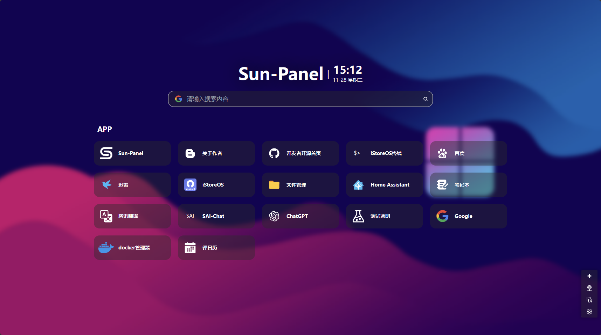
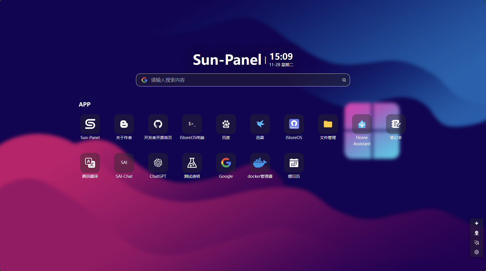
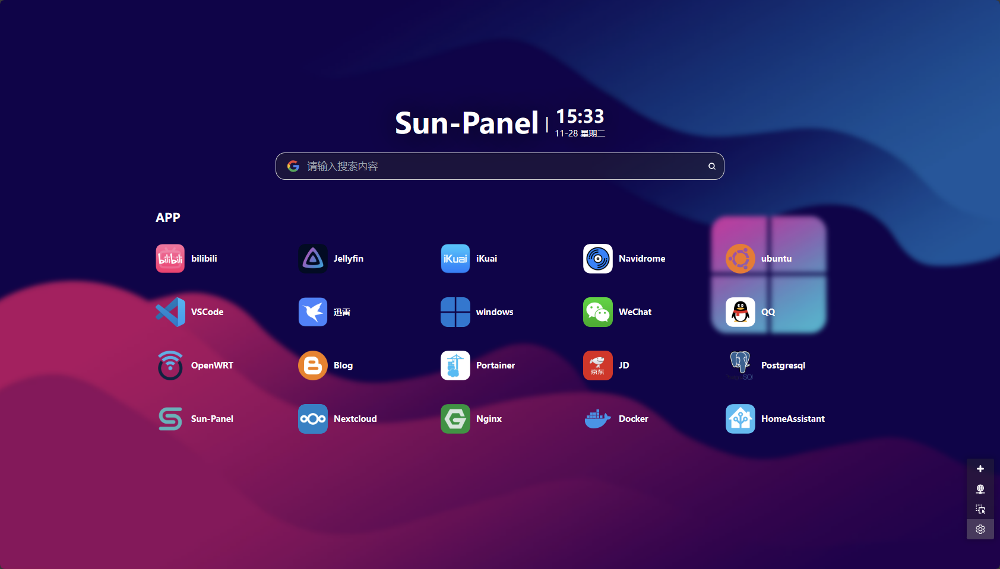
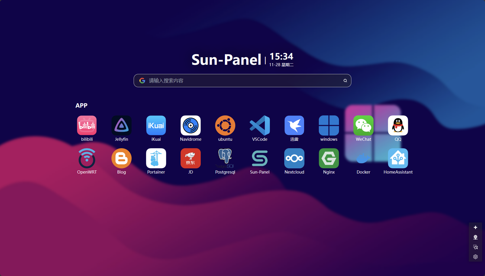
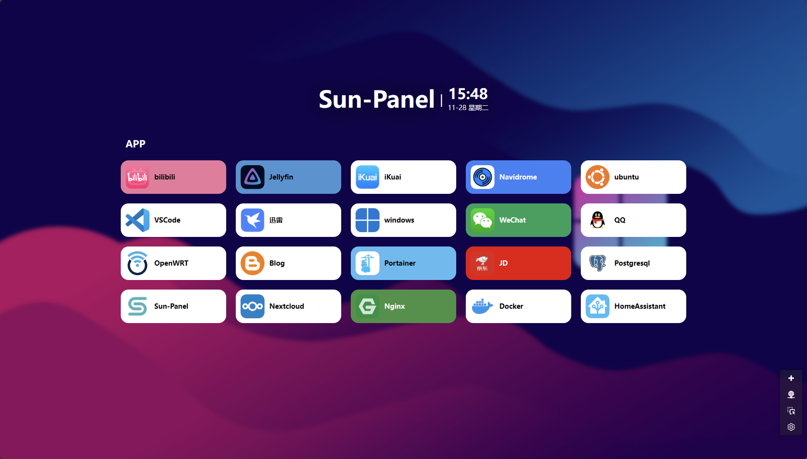
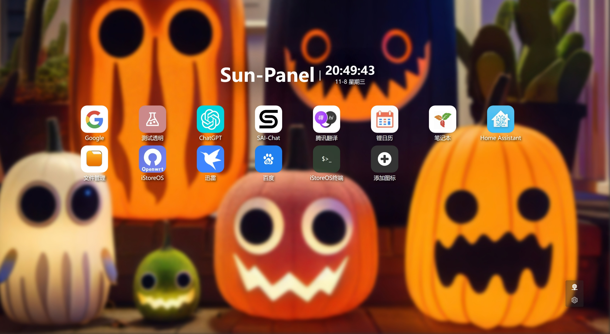
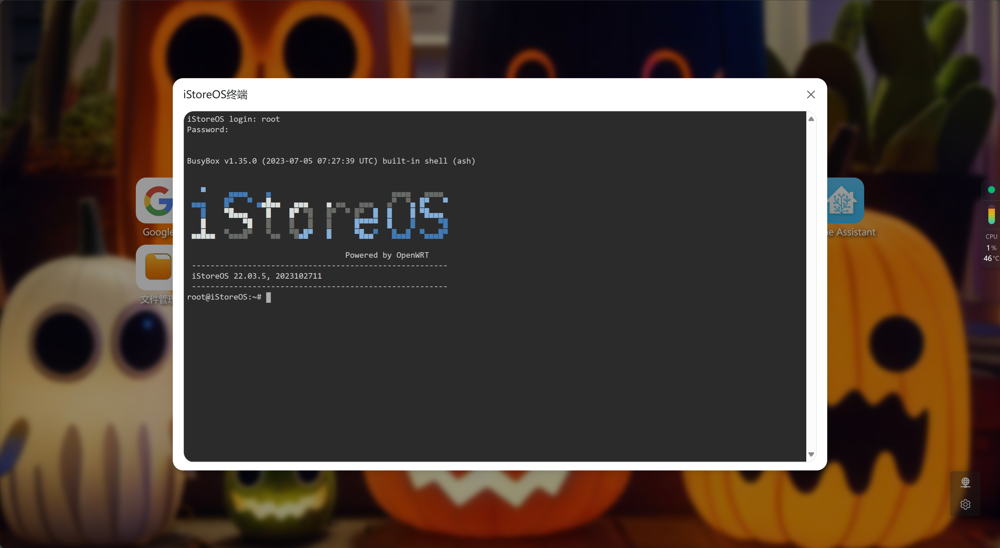
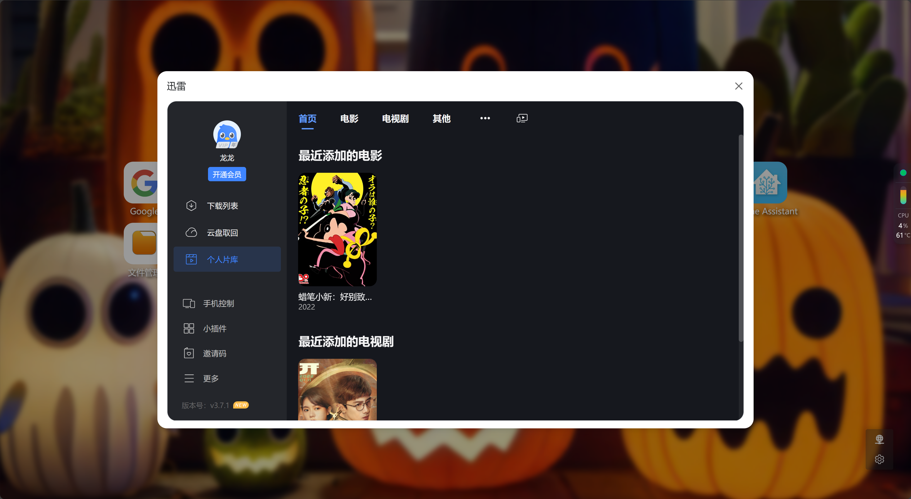

[[ 简体中文 ]](https://sun-panel-doc.enianteam.com/zh_cn/introduce/project.html) |
[[ English ]](https://sun-panel-doc.enianteam.com/introduce/project.html)

<div align=center>


# Sun-Panel

[](https://github.com/hslr-s/sun-panel)
[](https://gitee.com/hslr/sun-panel)
[](https://hub.docker.com/r/hslr/sun-panel) 
[](https://space.bilibili.com/27407696/channel/collectiondetail?sid=2023810)
[](https://www.youtube.com/channel/UCKwbFmKU25R602z6P2fgPYg)
<br>
[](https://github.com/hslr-s/sun-panel)
[](https://github.com/hslr-s/sun-panel/releases)
[](https://hub.docker.com/r/hslr/sun-panel)

[[ 中文文档 ]](https://sun-panel-doc.enianteam.com/zh_cn) |
[[ Document ]](https://sun-panel-doc.enianteam.com) |
[[ Demo ]](http://sunpaneldemo.enianteam.com) 

Server, NAS navigation panel, Homepage, Browser homepage.
<br>
一个服务器、NAS导航面板、Homepage、浏览器首页。

</div>

<!-- 


# Sun-Panel
Server, NAS navigation panel, Homepage, Browser homepage.
<br>
一个服务器、NAS导航面板、Homepage、浏览器首页。 -->




## 😎 特点

- 简洁
- 局域网内外网链接切换
- docker部署,对arm系统支持
- 上手简单，免修改代码
- 无需连接外部数据库
- 丰富图标自由搭配（文字图标+svg图标+内置三方图标库）
- 支持网页内置小窗口打开（部分网站屏蔽此功能）
- 占用资源小

## 🧊 最新完整文档（DOC）

[最新完整文档（DOC）](https://sun-panel-doc.enianteam.com/)


## 🎨 演示（demo）

[查看演示站](https://sun-panel-doc.enianteam.com/introduce/demo_site.html)

## 🐳 交流群&社区
开发者：**[红烧猎人](https://blog.enianteam.com/u/sun/content/11)**

QQ交流群，进不去可以点上方连接联系作者


Github社区板块：https://github.com/hslr-s/sun-panel/discussions

## 🍵 打赏

> 开源开发不易，如果觉得我的项目有帮到你，欢迎给我[打赏](./doc/donate.md)或者请我喝个奶茶☕（如果可以备注下您的昵称或者名字），你的支持就是我的动力，谢谢。

<a href="https://www.paypal.me/hslrs">
</img> 
</a>


|   |   |
| ------------ | ------------ |
|  |   |

## 🫓 TODO

- [x] 分组，拖拽排序
- [x] 导入导出功能
- [x] 增加访客账号
- [x] 帐号解除邮箱限制
- [x] 对上传的文件管理（针对账户增强重复利用，节省空间）
- [x] 服务器监控
- [x] 多国语言支持
- [ ] 用户自定义搜索框搜索引擎
- [ ] 搜索框样式自定义（背景颜色，文字颜色）
- [ ] docker管理器
- [ ] 计划任务


## 🖼️ 预览截图

**各种风格，自由搭配**







**内置小窗口**




## 🍜 使用运行教程

<div id="default-username"></div>

### 管理员首次登录

在 GateHome 管理台的「浏览器首页」启用并重启服务，再为页面列出的 SunPanel 管理员设置独立密码。升级后仍使用旧出厂密码的管理员也在这里设置新密码。独立运行此源码时，在本地终端执行下方的重置命令设置密码。

### 命令参数
|参数|说明|
|---|---|
|-h|查看命令说明|
|-config|生成配置文件（conf/conf.ini）|
|-password-reset|重置第一个用户的密码|

### 二进制文件运行

去 [Releases](https://github.com/hslr-s/sun-panel/releases) 下载二进制文件

执行示例

```sh
./sun-panel
```

#### 重置密码

执行示例

```sh
./sun-panel -password-reset
```
按终端提示输入两次新密码，输入内容会隐藏。

### docker 运行

目录挂载 `-v`，根据自己的需求选择：
|容器目录|说明|
|---|---|
|/app/conf|配置文件|
|/app/uploads|上传的文件|
|/app/database|数据库文件|
|/app/runtime|运行日志(不推荐挂载)|

1. 拉取镜像
```sh
docker pull hslr/sun-panel
```

2. 直接下载运行
```sh
docker run -d --restart=always -p 3002:3002 \
-v ~/docker_data/sun-panel/conf:/app/conf \
-v ~/docker_data/sun-panel/uploads:/app/uploads \
-v ~/docker_data/sun-panel/database:/app/database \
--name sun-panel \
hslr/sun-panel
```


### 自编译运行

[请参考完整文档](https://sun-panel-doc.enianteam.com/zh_cn/usage/compile.html)

## Star History

[](https://star-history.com/#hslr-s/sun-panel&Date)


## ❤️ 感谢

- [Roc](https://github.com/RocCheng)
- [jackloves111](https://github.com/jackloves111)
- [Rock.L](https://github.com/gitlyp)

## LICENSE
[MIT](./LICENSE)